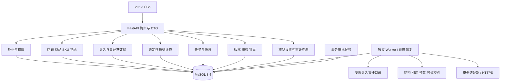
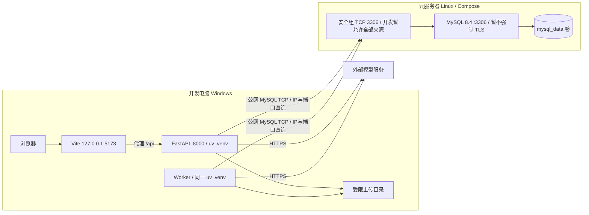
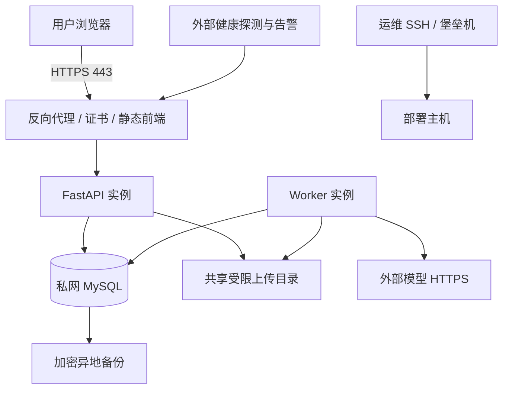
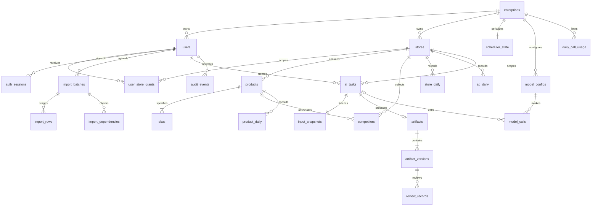
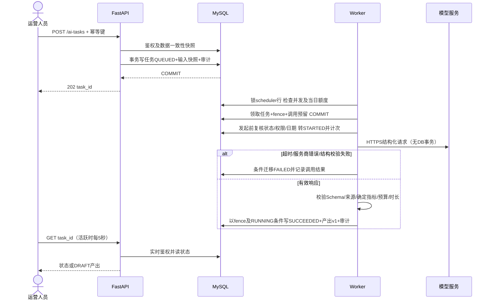
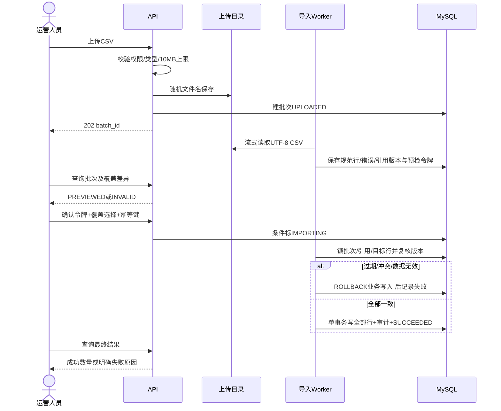

# 电商运营智能助手技术设计规格说明书（Design Spec）

| 元信息 | 内容 |
| --- | --- |
| 文档名称 | 电商运营智能助手技术设计规格说明书 |
| 版本 | v1.1 |
| 项目标识 | ecommerce-operation-agent |
| 架构师角色 | 系统架构师 / 全栈研发协作 |
| 日期 | 2026-10-16（Asia/Shanghai） |
| 状态 | 技术评审稿，可据此拆分开发；未实现业务代码 |
| 依据 PRD | `docs/电商运营智能助手-PRD.md` v1.0 |
| 其他输入 | `prompt/生成spec提示词.md` 及本次部署方式澄清 |
| 确认的技术约束 | 前后端分离、Vue 3、Python、FastAPI、SQLAlchemy、uv 管理隔离环境；优先使用现有 Python |
| 确认的开发部署方式 | 本机开发前端/API/Worker；云端部署数据库，本机通过公网直连数据库 |
| 配套文件 | 根目录单份 `docker-compose.yml`、`.env.example`、`docs/部署与本地开发准备.md` |

本版按用户后续要求改为单份Docker配置、项目名ecommerce-operation-agent及开发阶段不强制数据库TLS。本文将附件中的技术偏好作为设计输入，不把其中的“PRD 审核通过”当作生产部署授权。本次仅交付文档与基础设施配置，不连接云服务器、不启动容器、不修改原 PRD。PRD 已明确的业务规则保持一致；未由用户指定的库、数据库及实现方式均为本次推荐设计，不代表已有设施。PRD 中性能、可用性及保留目标继续作为验收目标，不宣称已经达到。

## 1. 架构设计概述

### 1.1 风格与核心决策

采用 **Vue 3 SPA + FastAPI 模块化单体 + 独立 Worker + MySQL 8.4**。API 与 Worker 使用同一个 Python 工程和领域服务，分别运行进程；API 处理鉴权、业务读写与提交，Worker 处理导入预检/入库及模型请求。MySQL 是业务数据、服务端会话、任务、调用额度及审计的持久化事实来源。

首版规模目标为 PRD 的 20 并发用户、20 店铺、10,000 商品与 100,000 条日数据；使用 MySQL 行锁和持久任务表即可提供每用户 2、企业 5 个模型调用的调度约束。首版不引入 Redis、Celery、RabbitMQ、Kubernetes 或独立向量库，避免为未提出的检索/高吞吐需求增加部署依赖。将来负载超出实测能力时通过 ADR 修订迁移队列，任务与幂等数据仍保留在数据库。

### 1.2 一致性与信任边界

- 业务写入、状态迁移及相应审计在同一事务提交。模型网络调用不持有数据库事务；迟到响应不得覆盖已取消/失败任务。
- 登录、授权、审核、额度、指标计算全部由服务端执行；前端隐藏按钮不构成权限控制。模型不能直接连接数据库或调用业务工具。
- 指标由 Decimal 确定性计算；模型返回结构化解释、来源引用与建议。渲染层只使用服务端指标，不能直接展示模型自行计算的指标表。
- 所有 AI 任务提交时冻结输入；审核绑定特定不可变正文版本；正式导出绑定该通过版本，而不是当前最新版本。
- 当前开发按用户确认通过公网 TCP 3306 直连 MySQL，暂不强制 TLS，安全组来源可暂为 0.0.0.0/0；这不代表加密或身份校验。此项为开发例外，生产恢复 TLS/私网与访问来源限制。数据库不是 HTTP 接口。

### 1.3 范围与容量假设

全部覆盖 FR-01～FR-21；FR-22～FR-24 为后续扩展，不实现电商自动同步、自动投放或素材生成。单企业、CNY、Asia/Shanghai 业务日期、多店铺授权、不采集买家个人信息。当前云服务器硬件、模型供应商及实际业务字段尚未提供，不假定 SLA 或已有平台授权。

## 2. 技术栈与依赖

### 2.1 选型表

| 层次 | 选型 | 来源/用途及约束 |
| --- | --- | --- |
| Python | 3.12 系列；本机实测 3.12.8 | 用户要求优先现有版本；不为本项目安装另一主版本 |
| 环境与依赖 | uv；本机实测 0.12.7 | 用户明确；`backend/.venv` 独立环境；提交 `pyproject.toml`、`uv.lock`、`.python-version` |
| 前端基础 | Vue 3、TypeScript、Vite | Vue 3 为用户指定，其余为推荐；Node 本机 24.19.0、npm 11.17.0，使用 npm 锁文件 |
| 前端界面/状态 | Element Plus、Vue Router、Pinia、ECharts、fetch | 推荐；表单、权限导航、图表；fetch 封装 CSRF、超时和统一错误，不存模型密钥 |
| API | FastAPI、Pydantic 2、Uvicorn | 用户指定 FastAPI；输入输出严格模型、自动 OpenAPI；同步 SQLAlchemy 服务通过普通 `def` 路由执行 |
| 数据访问 | SQLAlchemy 2、PyMySQL、Alembic | 用户指定 SQLAlchemy；同步事务与迁移，PyMySQL 支持服务端证书及主机身份校验 |
| 数据库 | MySQL 8.4 / InnoDB / utf8mb4 | 推荐；开发公网直连、暂不强制 TLS；提供单份基础设施 Compose |
| Worker | Python 独立进程、asyncio + httpx、SQLAlchemy 短事务 | 推荐；轮询持久任务；数据库操作不阻塞长时间模型调用；不使用 FastAPI BackgroundTasks 承载可靠任务 |
| 安全 | argon2-cffi、cryptography、服务端随机会话 | 推荐；Argon2id 密码哈希，AES-GCM 密钥加密；不使用不可撤销的纯无状态登录令牌 |
| AI 接入 | httpx + 提供方适配器 + Pydantic JSON Schema | 推荐；首个供应商支持结构化 JSON；连接/读取/总时限分开设置，关闭 SDK 自动重试 |
| 导入/导出 | Python csv、Decimal、Markdown 模板 | 推荐；10 MB / 10,000 行，无 pandas 或 office 解析依赖 |
| 测试 | pytest、httpx、Vue Test Utils、Playwright | 推荐；数据库一致性测试使用 MySQL 8.4，不能由 SQLite 替代 |
| 运维 | Docker Compose、结构化日志、Prometheus 指标 | Compose 用于当前基础设施；Prometheus/Grafana 可接现有平台，不是初期必须部署的软件 |

新引入依赖在初始化时按 Python 3.12、Node 24 的兼容组合安装并提交锁文件，CI 使用 `uv sync --frozen`、`npm ci`。文档不虚构尚未解析过的精确第三方 patch 版本。MySQL 当前采用 `mysql:8.4`，生产验收后固定 digest 并定期评估安全更新。

### 2.2 配置与环境隔离

| 配置 | 语义 | 校验/存储 |
| --- | --- | --- |
| APP_ENV | dev/test/staging/prod | 决定 Cookie、安全与测试开关；prod 不允许开发鉴权或明文远程 DB；DISABLED只可用于明确的开发例外 |
| DB_HOST / DB_PORT / DB_NAME / DB_USER / DB_PASSWORD | 数据库连接参数 | 分字段输入，使用 `sqlalchemy.URL.create` 构造，避免密码特殊字符破坏 URL |
| DB_TLS_MODE | DISABLED / VERIFY_IDENTITY / SSH_TUNNEL / LOCAL | 当前开发显式 DISABLED；生产远程连接必须 VERIFY_IDENTITY，或使用私网等独立评审方案 |
| DB_SSL_CA | 启用验证时的可信 CA 文件绝对路径 | DISABLED 时不要求；VERIFY_IDENTITY 时开启证书链与主机身份校验，缺 CA 启动失败；不能隐式降级 |
| ENCRYPTION_KEY / ENCRYPTION_KEY_ID | 32 字节主密钥及版本标识 | 操作系统环境或受限密钥文件；不进 DB/日志/git；加密备份，支持轮换 |
| SESSION_PEPPER | 会话摘要附加密钥 | 与加密主密钥分开，至少 32 随机字节；不下发浏览器 |
| UPLOAD_DIR | 导入文件受限绝对目录 | API 和 Worker 同机可访问；按随机批次 ID 建路径，不能用用户文件名拼路径 |
| ALLOWED_MODEL_HOSTS | 管理员可配置的模型域名允许集合 | 由部署配置维护，API 配置不能自行扩展到任意主机 |
| TRUSTED_ORIGINS | 当前应用同源地址 | dev 由 Vite 代理；prod 使用 HTTPS 同源；不允许 `*` 携带凭据 |
| MODEL_*（DB 配置） | 供应商、模型、加密密钥、超时、每日上限 | 业务配置版本化保存；真实调用前管理员填写，每日上限 > 0 |

`uv venv --python 3.12` 创建项目内隔离环境；以后通过 `uv run` 执行所有后端命令，禁止在系统 Python 中安装项目依赖。开发、测试使用不同库、账号、密钥与上传目录；测试环境不能访问真实经营数据。`.env*`、`.venv`、证书私钥均忽略提交；新增模板可显式放行 `.env.example`。

## 3. 模块 / 服务划分

### 3.1 模块拓扑



### 3.2 职责与 PRD 覆盖

| 模块 | 职责边界 | P0 对应 |
| --- | --- | --- |
| identity | 建号、登录、会话失效、角色/店铺作用域；不依赖模型 | FR-01、FR-02 |
| catalog | 店铺、商品、SKU、竞品 CRUD/归档；不执行网页采集 | FR-03、FR-04、FR-10 |
| ingestion | 六种 CSV 模板、预检、覆盖确认、日数据写入；不自行定义指标 | FR-05、FR-06 |
| analytics | 日期完整性、趋势、环比与同口径聚合；不调用模型计算数值 | FR-07 |
| ai_tasks | 输入 DTO、快照、幂等、队列、重试、取消及恢复 | FR-08、FR-16 |
| ai_generators | 六类提示词、模型适配器、结构校验；不直接写业务主数据 | FR-09、FR-11、FR-12、FR-13、FR-14、FR-15 |
| artifacts | 草稿版本、审核迁移、历史、复制/导出；不自动执行建议 | FR-17、FR-18、FR-19 |
| settings | 模型连接版本、测试、限额与密钥加密 | FR-20 |
| audit / observability | 事务审计、脱敏、日志和关联 ID；不存完整敏感请求 | FR-21 |

### 3.3 代码目录约定（待实现）

```text
frontend/
  src/{api,router,stores,views,components,types}
backend/
  pyproject.toml / uv.lock / .python-version / .venv/
  app/
    main.py / worker.py / cli.py
    core/{config,db,security,errors,logging}.py
    modules/{identity,catalog,ingestion,analytics,ai_tasks,ai_generators,artifacts,settings,audit}/
    # 各模块内部：router.py / schemas.py / service.py / models.py / repository.py
  alembic/ / tests/
# 当前部署只需根目录 docker-compose.yml 与 .env，不需要 deploy 证书/密钥目录
docs/
```

路由只处理协议、鉴权入口和 DTO；service 定义事务与状态机；repository 不自行提交。Worker 复用 service 而不通过 HTTP 回调 API。类型、错误码和内容 Schema 从服务端 OpenAPI/JSON Schema 生成前端类型；生成文件禁止手工修改。

## 4. 部署拓扑

### 4.1 已确认开发拓扑



API 的 HTTPS 模型连线仅用于管理员连接测试；实际业务生成全部由 Worker 调用。不得把模型访问密钥写在 Vue 或浏览器存储。

服务器项目目录为 `/opt/ecommerce-operation-agent`。仅上传 `docker-compose.yml` 和 `.env.example`，复制为 `.env` 填写密码后使用 `sudo docker compose up -d`。默认映射 `0.0.0.0:3306:3306`，不挂载证书、不强制 TLS；无需 public 覆盖文件。前端/API 在开发电脑不向公网监听，步骤见配套部署文档。

### 4.2 环境差异与后续完整部署

| 环境 | 应用与 DB | 区别 |
| --- | --- | --- |
| dev | 本机 Vite、API、Worker，云端开发库 | 用户确认方案；调试重载；公网TCP直连、暂不强制TLS，安全组可暂放行所有来源；不把本机应用端口映射公网 |
| test | CI/专用测试主机应用、隔离 MySQL 8.4 | 自动迁移/清理专属测试库；受控模型响应测试故障；另有真实供应商验收任务 |
| staging | 构建后的静态前端 + API + Worker + 隔离库 | 模拟生产 Cookie/HTTPS、资源与备份流程；禁用热更新；使用脱敏或虚构数据 |
| prod（后续实施） | HTTPS 网关 + 静态文件 + API + Worker；MySQL 私网 | 数据库停止公网发布；运维经 SSH/堡垒机；证书、备份、外部探测、告警接入 |



生产拓扑是后续方案，不表示本次已提供应用 Dockerfile 或完整上线编排。初期可以单应用实例和单库，但存在单机故障风险，99.5% 需实测与恢复保障；需要更高可用时使用托管高可用 MySQL、多 API 实例与共享文件存储。WAF/堡垒机可复用云平台能力，不作为已购设施。首版不要求 K8s。

## 5. 数据模型（ER）

### 5.1 通用建模规范

- 主键 `BIGINT UNSIGNED AUTO_INCREMENT`，JSON/API 一律以字符串返回 ID，防止 JavaScript 大整数精度损失；唯一业务编码 `VARCHAR(64)`，大小写敏感二进制排序规则。编码只去首尾空白，不悄悄更改大小写。
- 时间 `DATETIME(6)` 存 UTC，API ISO 8601 带时区；业务日 `DATE` 按 Asia/Shanghai 生成；金额 `DECIMAL(18,2)`，API 返回字符串；比率计算保留高精度，展示时统一舍入。
- 默认所有列非空；下表 `?` 为可空。业务表均有 `created_at/updated_at/created_by BIGINT`；企业种子、首个管理员及系统后台记录的 created_by 可空并标记系统来源，避免初始化循环依赖，其余操作记录实际用户。可修改行有 `version INT UNSIGNED DEFAULT 1`。状态用 `VARCHAR(32)` + CHECK/服务端 Enum；非负数及金额上限在数据库与 Pydantic 两层约束。
- 外键 `ON DELETE RESTRICT`，禁止级联删除历史。单企业也保存企业归属。跨店关联采用组合唯一键/FK（如 `products(id,store_id)` 与 `skus(product_id,store_id)`）保证同店；所有查询仍需要服务层作用域。
- 数据迁移由 Alembic 执行；禁止应用启动时 `create_all`。添加索引、字段回填与升级回滚都必须有演练记录。

### 5.2 ER 关系



### 5.3 账户与资料表

| 表 | 字段（除通用列） | 唯一键/关系 |
| --- | --- | --- |
| enterprises | id、name VARCHAR(100)、timezone VARCHAR(64)、currency CHAR(3)、active_model_config_id BIGINT? | 首版种子数据 1 行；active_model_config_id → model_configs；创建时先空再关联 |
| users | id、enterprise_id FK、login_name VARCHAR(64)、password_hash VARCHAR(255)、role VARCHAR(32)、status VARCHAR(16)、failed_count INT、locked_until DATETIME?、password_version INT、must_change_password BOOL | UNIQUE(enterprise_id,login_name)；ADMIN/SUPERVISOR/OPERATOR；ACTIVE/DISABLED；临时密码登录后仅允许改密/退出 |
| user_store_grants | id、user_id FK、store_id FK、granted_by FK、granted_at DATETIME | UNIQUE(user_id,store_id)；事务内校验同企业 |
| auth_sessions | id、user_id FK、token_digest BINARY(32)、csrf_digest BINARY(32)、password_version INT、expires_at、last_seen_at、revoked_at? | UNIQUE(token_digest)；INDEX(user_id,revoked_at)；不存原会话令牌 |
| stores | id、enterprise_id FK、code VARCHAR(64)、name VARCHAR(100)、platform VARCHAR(64)、external_id VARCHAR(128)?、category VARCHAR(128)?、notes TEXT?、status | UNIQUE(enterprise_id,code)；INDEX(enterprise_id,status,id) |
| products | id、store_id FK、code VARCHAR(64)、name VARCHAR(200)、category VARCHAR(128)、selling_points TEXT、brand VARCHAR(100)?、audience TEXT?、source_url VARCHAR(2048)?、status | UNIQUE(store_id,code)、UNIQUE(id,store_id)；INDEX(store_id,status,id) |
| skus | id、store_id、product_id、code VARCHAR(64)、spec_name VARCHAR(200)、price DECIMAL(18,2)、cost DECIMAL(18,2)? | UNIQUE(store_id,code)；组合 FK(product_id,store_id)；至少一个 SKU 在创建商品事务保证 |
| competitors | id、store_id FK、code VARCHAR(64)、product_id?、name VARCHAR(200)、platform VARCHAR(64)、brand VARCHAR(100)?、spec VARCHAR(200)?、price DECIMAL(18,2)?、selling_points TEXT?、excerpt TEXT?、source_note TEXT、source_url VARCHAR(2048)?、collected_at DATE、status | UNIQUE(store_id,code)；product_id 有值时验证同店组合 FK；INDEX(store_id,status,collected_at) |

归档使用状态，不删除关联记录；已有引用时店铺/商品编码不可修改。账户表身份修改与会话撤销同事务；用户授权每次请求实时查库，无长期权限缓存。

### 5.4 经营与导入表

| 表 | 字段（除通用列） | 唯一键/关系 |
| --- | --- | --- |
| store_daily | id、store_id FK、business_date DATE、paid_amount DECIMAL(18,2)、paid_orders BIGINT、visitors BIGINT、refund_amount DECIMAL(18,2)、batch_id? FK | UNIQUE(store_id,business_date)；CHECK 指标 ≥ 0 |
| product_daily | id、store_id、product_id、business_date、同上四指标、batch_id? FK | UNIQUE(product_id,business_date)；组合 FK(product_id,store_id)；INDEX(store_id,business_date,product_id) |
| ad_daily | id、store_id FK、channel VARCHAR(64)、business_date、spend DECIMAL(18,2)、impressions BIGINT、clicks BIGINT、attributed_amount DECIMAL(18,2)?、attribution_note VARCHAR(500)?、batch_id? FK | UNIQUE(store_id,channel,business_date)；INDEX(store_id,business_date)；归因金额不空则说明必填 |
| import_batches | id、enterprise_id、creator_id、store_id?、import_type、file_sha256 BINARY(32)、file_path VARCHAR(512)、status、row_count INT、new_count INT、overwrite_count INT、error_count INT、preview_token CHAR(64)?、preview_expires_at?、overwrite_confirmed BOOL、confirm_key VARCHAR(64)?、lease_owner?、lease_until?、error_code? | UNIQUE(creator_id,confirm_key)；INDEX(status,created_at,id)；状态按 PRD |
| import_rows | id、batch_id FK、row_no INT、business_key VARCHAR(256)、normalized_payload JSON、expected_target_version INT?、errors JSON、error_count INT、valid_business_key VARCHAR(256)?（生成列） | UNIQUE(batch_id,row_no)；UNIQUE(batch_id,valid_business_key)，生成表达式为 CASE WHEN error_count=0 THEN business_key ELSE NULL END；预检先检测重复并将所有冲突行标错，不静默去重 |
| import_dependencies | id、batch_id FK、entity_type VARCHAR(32)、entity_id BIGINT、expected_version INT | UNIQUE(batch_id,entity_type,entity_id)；绑定引用商品/店铺等预检版本 |

导入六类模板以 Pydantic 统一校验。预检暂存逐行规范化数据，合法批次产生 30 分钟有效的预检令牌及依赖版本。确认任务按稳定顺序锁定 store/目标行并复核：已有行版本一致、新增键仍不存在、引用状态未变，否则整批拒绝为 `IMPORT_STALE_PREVIEW`。新增竞态依赖唯一键回滚。确认成功在单一 InnoDB 事务中写入全部行及审计后标为成功，任何一行失败全回滚；批次失败状态在另一个短事务记录。

导入原始文件 30 天后删除，预检临时行在批次终态后 7 天清理；错误摘要、批次摘要和审计至少保留 180 天，不清除已入库经营事实。Worker 和 API 同机共享 UPLOAD_DIR；以后跨机需切换共享存储并调整 ADR。

### 5.5 任务、内容与运维表

| 表 | 字段（除通用列） | 唯一键/关系 |
| --- | --- | --- |
| ai_tasks | id、enterprise_id、store_id FK、creator_id FK、task_type、status、idempotency_key VARCHAR(64)、request_hash BINARY(32)、parent_task_id? FK、root_task_id?、retry_count INT、model_config_id FK、lease_owner?、lease_until?、fence_token BIGINT、queued_at、started_at?、deadline_at?、finished_at?、error_code?、error_message? | UNIQUE(creator_id,idempotency_key)；INDEX(status,queued_at,id)、INDEX(store_id,creator_id,created_at,id)；root 的累计重试 ≤ 2 |
| input_snapshots | id、task_id FK、input_params JSON、source_refs JSON、data_copy JSON、metrics JSON、missing_items JSON、schema_version VARCHAR(32)、metric_version VARCHAR(32)、prompt_version VARCHAR(32)、sha256 BINARY(32) | UNIQUE(task_id)；不可变；不包含模型密钥 |
| artifacts | id、task_id FK、store_id FK、author_id FK、title VARCHAR(200)、latest_version_id BIGINT? | UNIQUE(task_id)；INDEX(store_id,author_id,created_at,id)；latest FK 通过后续迁移添加避免建表环 |
| artifact_versions | id、artifact_id FK、version_no INT、schema_version VARCHAR(32)、content JSON、source_refs JSON、review_status、submitted_at?、reviewed_at? | UNIQUE(artifact_id,version_no)；INDEX(review_status,submitted_at,id)；正文不可变 |
| review_records | id、version_id FK、actor_id FK、action VARCHAR(16)、comment VARCHAR(1000)?、operation_key VARCHAR(64) | UNIQUE(actor_id,operation_key)；只追加；SUBMIT/WITHDRAW/APPROVE/REJECT |
| model_configs | id、enterprise_id FK、config_version INT、provider VARCHAR(64)、endpoint VARCHAR(2048)、model_name VARCHAR(128)、secret_cipher BLOB、key_id VARCHAR(64)、nonce BINARY(12)、timeout_seconds INT、daily_limit INT、revoked_at? | UNIQUE(enterprise_id,config_version)；不可变配置；当前配置由 enterprise 指针选择 |
| scheduler_state | enterprise_id PK/FK、updated_at | 调度互斥行；不得长时间持锁 |
| daily_call_usage | id、enterprise_id FK、usage_date DATE、consumed INT、reserved INT | UNIQUE(enterprise_id,usage_date)；日额度跨配置合计，不因切模型清零 |
| model_calls | id、enterprise_id、task_id? FK、config_id FK、actor_id FK、purpose、status、usage_date、request_key CHAR(64)、provider_request_id? VARCHAR(128)、usage_tokens? JSON、fence_token BIGINT、deadline_at、started_at?、finished_at?、error_code? | UNIQUE(request_key)；INDEX(enterprise_id,status,deadline_at)、INDEX(actor_id,status)；RESERVED/STARTED/SUCCEEDED/FAILED/UNKNOWN/RELEASED |
| audit_events | id、enterprise_id、actor_id? FK、store_id? FK、action VARCHAR(64)、target_type VARCHAR(64)、target_id VARCHAR(64)?、request_id VARCHAR(64)、result VARCHAR(16)、redacted_diff JSON、created_at | INDEX(enterprise_id,created_at,id)、INDEX(target_type,target_id,created_at)；系统动作 actor 可空；只追加 |

### 5.6 必须保持的事务不变量

1. 任务状态为 QUEUED/RUNNING/SUCCEEDED/FAILED/CANCELLED；审核状态为 DRAFT/PENDING_REVIEW/APPROVED/REJECTED，二者不混用。成功任务才创建产出及 v1；三项在同事务完成。
2. 快照、版本正文与审计是追加数据。修改草稿产生新版本，旧版本不再可提交；待审版本必须先撤回才可改。已经通过的旧版本始终可按明确版本号导出。
3. 审核/撤回通过条件更新或 `SELECT FOR UPDATE` 检查当前状态与版本；自审检查作者身份。并发保存通过 `If-Match` 对应 artifact 的 version 防止覆盖。
4. 同一企业调度和连接测试在 `scheduler_state` 行锁下检查活动 model_calls，限制每用户 2、企业 5。取消任务仍保留在途调用的占位，直到返回或截止时间，不因取消绕过并发。
5. 调用额度按企业及实际发起日计数；提交时做快速限额检查，Worker 调用前再次检查。预留在事务中增加 reserved，发起前转 STARTED 并将 reserved 转 consumed。预留后取消/未发起可释放，已发起失败/超时/取消均不返还 consumed。
6. 进程可能在持久化 STARTED 后、实际网络发送前崩溃，无法与外部提供方构造原子事务；此类 UNKNOWN 保守占用额度且不自动重发，审计标记供核对。若提供方支持幂等键则传 request_key，但不假设它能保证 exactly-once。不可把次数当成精确账单。
7. 跨日预留未发起的调用先释放旧日 reserved，再按新日额度重新预留；日额度由当前生效配置决定，历史调用内容仍使用任务冻结配置。测试同样计入额度且最多执行一次请求，不隐式重试。

## 6. 关键接口定义（契约 + OpenAPI + 错误码）

### 6.1 协议约定

- 基础路径 `/api/v1`，JSON UTF-8；时间 ISO 8601、ID 字符串、金额十进制字符串。查询分页 `page≥1,page_size=1..100`，默认 20，按 created_at/id 倒序稳定排序。
- 成功响应 `{data,request_id}`，分页 data 为 `{items,total,page,page_size}`；错误 `{error:{code,message,field_errors?,retryable},request_id}`。422 的 FastAPI 默认错误转为该格式，不泄露堆栈。
- 服务端会话 Cookie：`ea_session`（HttpOnly，prod Secure，SameSite=Lax）。所有修改接口包括登录校验 Origin；登录后修改还须 `X-CSRF-Token`，与服务端会话绑定。开发仅同源 Vite 代理，不配置跨域通配。
- 写操作按接口要求带 `Idempotency-Key`；同用户同键同请求返回原结果，同键不同 body 返回 409。用户授权、资源可见性和状态验证在幂等回放前重做。
- 更新资源带 `If-Match: "<version>"`，缺失 428，版本冲突 409。不可见单个资源统一 404，不透露所属店铺；用户无某项全局能力返回 403。列表只返回作用域内记录。

### 6.2 八组核心契约

| 编号 | 方法及路径 | 请求/前置 | 成功响应 | 关键错误 |
| --- | --- | --- | --- | --- |
| API-01 | POST `/auth/login`；GET `/auth/session`；POST `/auth/logout` | login `{login_name,password}`，Origin 校验与速率限制；session/logout 需会话，logout 需 CSRF | login/session 200 `{user:{id,role,store_ids,must_change_password},csrf_token,expires_at}`；登录 Set-Cookie；logout 204 | 401 AUTH_INVALID_CREDENTIALS；423 AUTH_LOCKED；401 AUTH_SESSION_EXPIRED |
| API-02 | POST `/products`；PATCH `/products/{id}`；GET `/stores/{id}/dashboard` | 商品 `{store_id,code,name,category,selling_points,skus:[{code,spec_name,price,cost?}]}`；编辑 If-Match；看板 `start_date,end_date` ≤90 日 | 创建 201 `{id,version,skus}`；编辑 200；看板 200 `{period,completeness,metrics,trend,previous_period,warnings}` | 409 DATA_DUPLICATE_KEY / DATA_VERSION_CONFLICT；422 DATA_INVALID；404 RESOURCE_NOT_FOUND |
| API-03 | POST `/imports`；GET `/imports/{id}`；POST `/imports/{id}/confirm` | 上传 multipart `{type,store_id?,file}` ≤10MB；确认 `{preview_token,allow_overwrite}` + Idempotency-Key | 上传 202 `{id,status:"UPLOADED"}`；查询含计数/错误/预检令牌；确认 202 `{id,status:"IMPORTING"}`，Worker 原子入库 | 413 IMPORT_FILE_TOO_LARGE；422 IMPORT_INVALID_ROWS；409 IMPORT_STALE_PREVIEW；409 IMPORT_OVERWRITE_REQUIRED |
| API-04 | POST/GET `/ai-tasks`；GET `/ai-tasks/{id}` | 创建包含 task_type、store_id、类型专属 input + Idempotency-Key；选定来源均有权限；列表page/page_size | 首次202、同键同输入回放200；详情追加错误码、产出ID、时间、重试余量、冻结快照与DRAFT正文；列表按权限分页 | 422 DATA_INVALID；409 MODEL_NOT_CONFIGURED/IDEMPOTENCY_CONFLICT；429 AI_DAILY_LIMIT；404 RESOURCE_NOT_FOUND |
| API-05 | POST `/ai-tasks/{id}/cancel`；POST `/ai-tasks/{id}/retries` | 作者或具管理权限；重试仅 FAILED + Idempotency-Key；取消终态返回已终态 | cancel 200 `{id,status}`；retry 202 `{id,parent_task_id,status:"QUEUED",retry_count}` | 409 AI_INVALID_STATE；409 AI_RETRY_EXHAUSTED；429 AI_DAILY_LIMIT |
| API-06 | POST `/artifacts/{id}/versions`；POST `/artifact-versions/{id}/submit`；POST `/artifact-versions/{id}/withdraw` | 作者、If-Match；保存 `{base_version_id,title,content}`；提交/撤回带 Idempotency-Key | 保存 201 `{id,version_no,review_status:"DRAFT",artifact_version}`；状态操作 200 返回该版本状态 | 409 ARTIFACT_VERSION_CONFLICT / REVIEW_INVALID_STATE；422 ARTIFACT_INVALID_CONTENT |
| API-07 | POST `/artifact-versions/{id}/reviews`；GET `/artifact-versions/{id}/export` | 审核 `{decision:"APPROVE"或"REJECT",comment?}` + If-Match + Idempotency-Key；导出 `mode=draft或official` | 审核 200 `{id,review_status,reviewed_at}`；导出 200 `text/markdown` + 安全文件名 Content-Disposition + `Cache-Control: no-store` | 403 REVIEW_SELF_FORBIDDEN；422 REVIEW_COMMENT_REQUIRED；409 REVIEW_INVALID_STATE；409 EXPORT_NOT_APPROVED |
| API-08 | GET/PUT `/settings/model`；POST `/settings/model/test`；GET `/settings/model/calls`、`/settings/model/calls/{id}`；GET `/audit-events` | 管理员；配置保存需要 If-Match；测试 `{config_version}` 及 Idempotency-Key；审计筛选 actor/store/action/date | 配置 200；测试首次接收 202、同键回放 200，均返回持久 `{call_id,config_id,status,ok,latency_ms,error_code,usage_tokens,created_at,finished_at}`；调用列表返回最近20项及上海当日额度；审计返回分页 | 403 AUTH_FORBIDDEN；409 DATA_VERSION_CONFLICT/IDEMPOTENCY_CONFLICT；422 MODEL_HOST_NOT_ALLOWED；429 AI_DAILY_LIMIT/AI_CONCURRENCY_LIMIT；供应商错误作为调用记录 error_code 返回 |

连接测试异步接收后由Worker执行至配置超时，浏览器短请求查询调用记录，不要求创建接口保持整个模型等待时长；不包含在普通查询P95中。测试失败同样落库调用记录，不返回原始服务商响应体。浏览器超时或断连不自动重试，可用Idempotency-Key对账。

### 6.3 六种 task input 与内容 Schema

`task_type` 是判别字段，Pydantic 使用 discriminated union，`extra="forbid"`，不接受另一任务类型遗留的字段。

| task_type | input 必填 | 可选/边界 |
| --- | --- | --- |
| PRODUCT_ANALYSIS | product_id、goal | start_date/end_date；无数据输出资料分析 |
| COMPETITOR_ANALYSIS | product_id、competitor_ids（1–5） | dimensions；必须有来源和采集日期 |
| THEME_IDEAS | product_ids（1–5）、goal、audience | count 默认5、1–10；tone、constraints |
| VIDEO_SCRIPT | product_id、goal、audience、duration_seconds（15/30/60） | theme、style、forbidden_terms |
| AD_STRATEGY | product_ids（1–5）、goal、start_date、end_date、budget、channels（1–5） | history_period、audience、target_metrics；预算 >0 |
| BUSINESS_REVIEW | start_date、end_date、goal | 1–90日；自动推导紧邻等长上期；两期至少各一条店铺记录 |

任务响应和保存内容共享如下概念结构：

实现进度（2026-10-18）：首个可执行生成器为PRODUCT_ANALYSIS资料模式，当前input严格仅含product_id/goal，冻结名称、分类、卖点、品牌、人群，不纳入SKU及经营数据。上表中的日期参数和其他五类属于后续契约，目前提交这些类型/多余字段会返回422。任务取消、根任务累计两次显式重试、租约/围栏恢复、只读DRAFT已实现；草稿审核与导出接口仍待后续交付。租约以任务id+递增fence_token标识领取方，不执行自动接管重发。

```json
{
  "schema_version": "1",
  "task_type": "PRODUCT_ANALYSIS",
  "title": "示例商品资料分析",
  "analysis_mode": "PROFILE_ONLY",
  "metric_refs": [],
  "facts": [{"text": "已提供规格为500克", "source_refs": ["D1"]}],
  "hypotheses": [],
  "recommendations": [{"text": "建议验证包装诉求", "source_refs": [], "evidence_type": "SUGGESTION"}],
  "missing_items": ["未提供经营日数据"],
  "payload": {}
}
```

`payload` 按类型细化：商品含 strengths/issues/actions；竞品含 comparison_rows/opportunities；创意含固定数量 ideas（name/insight/angle/direction/cta）；脚本含 shots（start/end/visual/voiceover/subtitle/props）和标题/收尾；投放含 allocations（channel/amount）/tests/stop_rules；复盘含 anomalies/assumptions/next_actions。金额占比由服务器依据金额生成；指标正文由 metric_refs 指向服务端 metrics 渲染，不接受模型自造指标值。

事实数字除可验证的产品属性外必须使用结构化引用（source_ref + field 或 metric_ref），渲染时替换为快照原值；自然语言内检测出无依据的经营数值声明则拒绝。该机制能够校验结构与来源，不能证明模型每个语义判断都正确，仍须人工审核。创意中的拍摄时长、主题数量、试验建议阈值属于建议参数，需标记为建议而不是经营事实。

编辑版本也使用同一 Schema 与校验器，不通过自由 HTML 绕过预算/时长/来源校验。正文上限 100,000 字符；用户可以更改文字与建议，确定性指标不可手工改写。模型原始响应最多 1MB，超过限制失败并清理临时内容。

### 6.4 OpenAPI 3.1 核心片段

以下是可解析的最小示例，仅展示商品分析创建契约；完整实现由 FastAPI 生成并扩充全部判别联合、鉴权及错误响应。

```yaml
openapi: 3.1.0
info:
  title: Ecommerce Operations Agent API
  version: 1.0.0
paths:
  /api/v1/ai-tasks:
    post:
      operationId: createAiTask
      security:
        - sessionCookie: []
      parameters:
        - in: header
          name: Idempotency-Key
          required: true
          schema: {type: string, minLength: 16, maxLength: 64}
        - in: header
          name: X-CSRF-Token
          required: true
          schema: {type: string}
      requestBody:
        required: true
        content:
          application/json:
            schema:
              type: object
              additionalProperties: false
              required: [store_id, task_type, input]
              properties:
                store_id: {type: string, pattern: '^[0-9]+$'}
                task_type: {const: PRODUCT_ANALYSIS}
                input:
                  type: object
                  additionalProperties: false
                  required: [product_id, goal]
                  properties:
                    product_id: {type: string, pattern: '^[0-9]+$'}
                    goal: {type: string, minLength: 1, maxLength: 2000}
      responses:
        '202':
          description: Queued with an immutable snapshot
          content:
            application/json:
              schema:
                type: object
                required: [data, request_id]
                properties:
                  request_id: {type: string}
                  data:
                    type: object
                    required: [id, status, snapshot_id, queued_at]
                    properties:
                      id: {type: string}
                      status: {const: QUEUED}
                      snapshot_id: {type: string}
                      queued_at: {type: string, format: date-time}
        '401': {description: Session missing or expired}
        '404': {description: Resource missing or not visible}
        '409': {description: Idempotency conflict or model not configured}
        '422': {description: Input validation failed}
        '429': {description: Daily call quota exhausted}
components:
  securitySchemes:
    sessionCookie:
      type: apiKey
      in: cookie
      name: ea_session
```

### 6.5 错误码体系

| 段位 | 前缀及代表码 | HTTP/处理 |
| --- | --- | --- |
| 10xx 身份 | AUTH_INVALID_CREDENTIALS、AUTH_SESSION_EXPIRED、AUTH_FORBIDDEN、AUTH_LOCKED、AUTH_CSRF_INVALID | 401/403/423；会话过期跳登录，权限失败不自动重试 |
| 20xx 数据/导入 | RESOURCE_NOT_FOUND、DATA_INVALID、DATA_DUPLICATE_KEY、DATA_VERSION_CONFLICT、IMPORT_INVALID_ROWS、IMPORT_STALE_PREVIEW、IMPORT_OVERWRITE_REQUIRED | 404/409/422；冲突提示刷新，导入错误定位行 |
| 30xx 任务/模型 | AI_INVALID_INPUT、AI_DAILY_LIMIT、AI_INVALID_STATE、AI_RETRY_EXHAUSTED、MODEL_NOT_CONFIGURED、MODEL_HOST_NOT_ALLOWED、MODEL_PROVIDER_ERROR、MODEL_TIMEOUT、MODEL_OUTPUT_INVALID、AI_QUEUE_TIMEOUT、AI_INTERRUPTED | 409/422/429/502/504；异步失败写入任务 error_code；不对非幂等调用静默重发 |
| 40xx 版本/审核 | ARTIFACT_VERSION_CONFLICT、ARTIFACT_INVALID_CONTENT、REVIEW_SELF_FORBIDDEN、REVIEW_COMMENT_REQUIRED、REVIEW_INVALID_STATE、EXPORT_NOT_APPROVED | 403/409/422；保留本地未提交内容并提示解决冲突 |
| 90xx 系统 | SYS_DB_UNAVAILABLE、SYS_INTERNAL、IDEMPOTENCY_CONFLICT、PRECONDITION_REQUIRED | 503/500/409/428；返回 request_id，不暴露连接信息 |

响应 `code` 使用上述符号码，段位用于文档和监控分类，不另外返回含糊的第二套数字码。数据库唯一键异常统一转换，原始 SQL 不回传。

### 6.6 其余 P0 路由清单

为避免仅定义 AI 而遗漏管理能力，实现时至少提供下列路由，入参字段遵循第 5 章及 PRD 字段长度，状态变更均需 CSRF、权限、版本条件和审计：

- `/users` GET/POST，`/users/{id}` PATCH，`/users/{id}/password-reset` POST，`/users/{id}/store-grants` PUT；重置通过交互指定临时密码并要求首次修改，不返回原密码。
- `/stores` GET/POST，`/stores/{id}` GET/PATCH，`/stores/{id}/archive` POST；商品与竞品均提供列表/详情/新建/更新/归档。SKU 随商品事务更新，引用历史数据时不能随意更换归属。
- `/daily-data/{store|product|ad}` GET/POST/PATCH；手工覆盖已有键时明确提供 `overwrite=true` 及版本，不能以“新建”静默覆盖。
- `/import-templates/{type}` GET，`/imports/{id}/errors` GET；下载错误 CSV 使用公式转义，实时校验上传者/角色作用域。
- `/ai-tasks` GET，`/artifacts` GET，`/artifacts/{id}` GET，`/artifacts/{id}/versions` GET，`/artifact-versions/{id}` GET；`/artifact-versions/{id}/copy` POST 生成带状态标识的纯文本并写审计。
- `/settings/model` GET 返回脱敏配置，`/settings/model/calls` GET 返回管理员可见的调用摘要；`/health/live`、`/health/ready` 和受限 `/metrics`，健康响应不暴露服务凭据。

归档或停用属于显式状态迁移，不提供业务 DELETE。用户密码修改入口 `/auth/change-password` 校验旧密码，撤销旧会话并要求重新登录；初始管理员通过 CLI 交互创建。

## 7. 关键流程时序图

### 7.1 异步生成、额度、失败与落库



**实现细节**：Worker 轮询周期 1 秒；单调度事务用 `FOR UPDATE` 锁企业 scheduler 行，任务选择用 `FOR UPDATE SKIP LOCKED`，按排队时间和 ID 取最早可运行任务，跳过已达用户并发上限者。行锁最长只覆盖领取/计额的短事务，不覆盖模型等待。导入使用独立轮询与最多 1 个导入执行槽，避免长导入占据模型调度锁。

每 10 秒续租，租期 30 秒；总截止按配置 30–300 秒并额外留 5 秒校验落库窗口。恢复器对未发起的 RESERVED 调用释放预留并将任务失败为 AI_INTERRUPTED；对 STARTED 且租约过期的调用标记不确定，在原截止前继续占用并发槽，到原截止后释放但不返还额度。任务转失败，禁止自动重新发起；需要人员明确重试。排队超过 10 分钟失败。

取消先条件更新为 CANCELLED，Worker 尽力关闭 HTTP；已发起的调用直到返回/截止仍占槽。最终落库必须检查 status、fence、deadline、账号与店铺有效状态；失效或取消时不创建产出。网络中断且响应是否送达不可判定时，不承诺完全无重复费用。

### 7.2 预检、并发覆盖与原子导入



重复确认返回原批次，不重复入库；网络中断后先查询批次状态。Worker 在业务写事务中崩溃时 InnoDB 回滚，恢复器检查租约后确认批次成功与否，再允许安全恢复未提交批次，不把模型任务的重试策略机械用于导入。

## 8. 非功能设计

### 8.1 安全、合规与权限落地

| PRD 指标 | 设计手段与验证 |
| --- | --- |
| NFR-05 密码/会话 | Argon2id 哈希，建号/改密两层校验 12–64 字符及两类字符；失败计数/15分钟锁定在用户行锁下更新；服务端 session 30分钟闲置/8小时绝对过期，停用、退出、重置即时撤销 |
| NFR-06 越权阻断 | 统一 `Scope` 服务：企业、角色、授权店铺、作者条件；列表和详情同策略；Worker 发起前重新鉴权；下载时查当前授权；无永久公开下载 URL |
| NFR-06 TLS/密钥 | 当前开发按用户确认暂不强制数据库TLS，未满足该项生产加密目标；生产恢复TLS及VERIFY_IDENTITY/私网；HTTPS 模型服务；AES-256-GCM 加密密钥，随机 nonce、AAD 包含企业/配置版本，主密钥不与密文同库；密钥掩码与日志结构白名单 |
| NFR-07 输入/输出 | 参数化 SQL，限制文件和字符串大小，CSV 以 csv 模块按模板解析；禁止目录跳转；Markdown 禁用 HTML 并安全渲染；URL 仅允许 http/https 展示，不自动抓取；导出 CSV 公式转义 |
| NFR-07 SSRF/注入 | 模型主机允许列表 + DNS/IP 校验，拒绝私网/回环/链路本地/元数据和非443端口，禁用重定向及非授权环境代理；建立连接时固定到已验证地址但保留原始 SNI/证书主机，防 DNS 重绑定；模型无外部工具权限 |
| NFR-11 审计 | 状态变更同事务插入事件；只追加仓储接口；运行账号禁止 UPDATE/DELETE 审计表；失败鉴权写脱敏安全日志/审计，不记录输入密码；特权 DBA 操作需运维侧审计 |
| NFR-12 最小化 | 不提供买家个人信息导入字段；请求模型前使用字段白名单；审查实际载荷、供应商数据政策和跨境边界，不宣称系统自动完成合规认定 |

连接测试也必须使用同一主机允许列表与出站策略。API_KEY 更新后不将旧密钥回显，管理员留空表示保持旧值；轮换为新配置版本，紧急撤销旧配置时尚未执行的关联任务明确失败，不暗中换模型。

### 8.2 性能与一致性

| PRD 指标 | 设计手段与验证 |
| --- | --- |
| NFR-01/02 查询与看板 | 以 store_id/date 联合索引聚合，列表分页不加载正文；消除 N+1；一次看板批量拉本期/上期；EXPLAIN 检查计划；无 Redis 缓存，先保证更新后立即可见 |
| NFR-03 CSV ≤30秒 | 流式读取并限行/限文件，规范行批量暂存，每批500条；确认使用批量写和稳定加锁顺序；整体事务原子提交；在云数据库真实网络条件下测量，超标先优化往返/批大小 |
| NFR-03 提交≤2秒 | 不等待模型/CSV长处理；冻结时聚合统计并限制≤90日、≤5个产品/竞品；模型只接收必要汇总与每日≤90点，完整原始数据保留本地快照 |
| NFR-04 模型成功率 | 六套 Schema/提示词版本化，真实30例评测；提供方异常、超时、契约失败分开统计；超时独立配置，不靠无限重试提高表面成功率 |
| 公网 DB 延迟 | SQLAlchemy `pool_pre_ping=True`、`pool_recycle=1800`、连接超时5秒；每 API 进程 pool_size=5/max_overflow=5，Worker pool_size=5/max_overflow=0；避免跨网络循环逐行事务 |
| 并发与死锁 | 先锁 scheduler/批次等互斥行再按主键顺序锁目标行；死锁仅对“尚未外部调用”的数据库事务最多重试2次并短抖动；模型发起后禁止重跑整个服务函数 |

指标服务按 PRD 处理缺日期、0分母、退款超支付、日 UV 累加、跨渠道归因不可去重等；比率不做日均。投放金额和时长校验采用 Decimal/整数，比例由服务器派生，避免模型小数误差。跨日数据按业务时区转换，不依赖系统默认时区。

### 8.3 可用性、恢复与保留

- `/health/live` 只反映进程；`/health/ready` 查询 DB 和迁移版本，模型服务故障不把基础资料服务判死。云库断开时读写返回 503，不将请求数据暂存在浏览器假装保存。
- API 可重启，登录/队列/审核状态均持久化。Worker 依赖租约、fence 与截止收敛，数据库锁不能独立保证模型 exactly-once；用故障注入验证取消、断网和崩溃后的状态。
- 生产单库/单机并不自动满足 99.5%；实施健康探测、备份、恢复演练，监测实际月度可用性。更高 SLA 再引入托管主备和 API 多副本，不能只增加容器数就宣称高可用。
- 每日加密备份数据库及必要文件、主密钥，独立存储；RPO≤24小时、RTO≤4小时，发布前一次隔离恢复。备份期间 schema 不变，应用迁移与备份协调；对还原数据验证样本行、产出与密钥解密。
- 原始 CSV 30天、运行日志30天、批次/审计至少180天；报告/快照不自动清理，任何后续清理必须保证引用完整和业务批准。清理任务失败产生告警事件。

### 8.4 可观测与测试出口

| 观测项 | 实现/验收 |
| --- | --- |
| 结构化日志 | request_id、task_id、batch_id、call_id、脱敏 actor/store、状态/耗时/错误码；禁止记录Cookie、密码、模型密钥、完整提示词和完整业务正文 |
| 指标 | HTTP P95、错误率、队列长度/最长等待、运行调用数、成功/超时/校验失败、日额度、导入耗时、DB连接池使用、Worker心跳 |
| 告警 | 5分钟模型失败率≥20%且样本≥10、Worker无心跳>30秒、队列等待接近10分钟、DB不可用、备份失败；初期产生结构化运维事件，生产接告警接收器 |
| 前端可用性 | Chrome/Edge近两稳定版、1366×768，表单键盘可用；请求错误保留输入；轮询每5秒、页面失焦暂停/回焦立即刷新；不展示伪百分比进度 |
| 功能测试 | 逐项自动化覆盖AC-01～AC-21与交叉异常；服务层事务测试、API鉴权测试、前端审核与导入E2E；真实MySQL验证唯一键/锁/回滚 |
| AI测试 | Schema/引用/预算/时长以受控响应验证拒绝行为；30例真实模型评测验证联调；语义准确性由人工审核，不用简单字符串相等充当质量结论 |

## 9. 设计决策记录（ADR）

| 编号 | 背景与选项 | 最终选择及理由 | 后果/重新评估条件 |
| --- | --- | --- | --- |
| ADR-01 | 初期规模较小；微服务 vs 模块化单体 | 模块化单体、API/Worker分进程；模块边界清晰且减少网络与部署成本 | 共享发布版本；团队/负载出现独立扩缩需求时再拆服务 |
| ADR-02 | 需要可靠队列但仅企业5并发；Redis/Celery vs MySQL | MySQL持久任务+短行锁+租约/fence；无额外队列软件 | 必须实现恢复与不确定调用语义；调度争锁或吞吐超实测目标时迁移队列 |
| ADR-03 | Python版本与同步事务；异步驱动 vs PyMySQL | 复用3.12.8、uv隔离；同步SQLAlchemy/PyMySQL，模型HTTP独立异步 | 数据库操作走线程/同步边界，不能在事件循环做长阻塞；吞吐提高再评估asyncmy |
| ADR-04 | 本机需直连云DB；公网TCP、SSH或TLS白名单 | 用户后续明确开发阶段只开放3306、暂不强制TLS，安全组可暂放行所有来源；单份Compose+.env | 明确接受开发连接可能不加密；不代表满足生产NFR；上线前恢复TLS/私网与来源限制 |
| ADR-05 | 登录停用需即时生效；JWT vs 服务端会话 | 数据库随机会话+HttpOnly Cookie+CSRF，不使用长期JWT | 每请求读会话/权限，有DB依赖；初期规模成本可控 |
| ADR-06 | 模型可能计算错误；自由Markdown vs 结构化生成 | JSON Schema+指标引用+确定渲染+人工审核，导出Markdown | 需维护六套Schema和编辑器；模型语义不能完全自动验证 |
| ADR-07 | 生成快照/审核追溯；覆盖正文 vs 不可变版本 | 输入快照与正文版本不可变，状态迁移/审核追加 | 更多存储；历史不能随基础资料更新而重写；暂不硬删除 |
| ADR-08 | 仅结构化业务数据；引入RAG框架 vs 直接适配 | httpx+供应商适配器，无Agent工具调用/向量数据库 | 适配器需提供超时/用量/错误规范；未来知识库需求再评估RAG |

## 10. 任务分解清单（有序、含依赖）

当前为研发编排，不等于本次已执行这些实现任务。表中“可并行”指后续团队实施方式，不要求额外创建代理或新聊天。

| 编号 | 模块 | 前置依赖 | 实现及交付出口 | 对应需求 |
| --- | --- | --- | --- | --- |
| T-01 | 工程初始化 | 无 | 建Vue/TS项目；Python3.12+uv独立.venv；锁文件、格式检查、配置模板 | 全局 |
| T-02 | 基础设施 | 无；与T-01可并行 | 用户部署单份Compose、配置密码和安全组，后端验证公网DB连通；生产另验TLS | NFR-06 |
| T-03 | 数据基础 | T-01、T-02 | SQLAlchemy模型/Alembic全表迁移、索引、种子企业、迁移与运行账号分离 | FR-01～FR-21 |
| T-04 | API基础 | T-01 | DTO/错误码/分页/请求ID/CSRF/事务边界，OpenAPI类型生成；可与T-03并行 | 全局 |
| T-05 | 身份权限 | T-03、T-04 | CLI初始管理员、建号、改密、会话、店铺Scope、停用与授权失效测试 | FR-01、FR-02 |
| T-06 | 基础资料 | T-05 | 店铺/商品/SKU/竞品接口、表单、列表、归档；事务审计基础 | FR-03、FR-04、FR-10、FR-21 |
| T-07 | 导入与日数据 | T-06 | 六模板、手工表单、预检、差异确认、原子写入及过期检测 | FR-05、FR-06 |
| T-08 | 指标与看板 | T-06 | 指标纯函数、日历完整性、聚合查询、图表；可与T-07并行 | FR-07 |
| T-09 | 模型配置 | T-05 | 允许域名、加密主密钥、配置版本、真实测试与调用统计 | FR-20 |
| T-10 | 任务调度 | T-03、T-05、T-09 | 快照、幂等、队列/并发/额度/租约/fence、取消、重试、恢复 | FR-08、FR-16 |
| T-11 | 六类生成器 | T-08、T-09、T-10 | 供应商适配、六输入/输出Schema、指标/引用/时长/预算校验、30例真实评测 | FR-09、FR-11～FR-15 |
| T-12 | 版本编辑 | T-10；完整验证依赖T-11 | 结构化内容渲染/编辑、不可变版本、乐观锁、提交/撤回 | FR-17 |
| T-13 | 审核导出 | T-12 | 非作者审核、并发迁移、历史筛选、草稿与指定通过版本导出 | FR-18、FR-19 |
| T-14 | 审计可观测 | T-04起逐模块集成，完成依赖T-13 | 敏感操作脱敏、日志指标、错误告警、权限反向用例 | FR-21、NFR-10/11 |
| T-15 | 集成与发布准备 | T-07、T-08、T-11、T-13、T-14 | AC全覆盖，公网DB性能、安全、崩溃恢复、浏览器验证、备份恢复演练 | 全部P0/NFR |

每个任务完成后更新接口 Schema、迁移文件及适用测试；不等到联调才补权限。先演示M1数据基础，再M2真实AI，最后M3审核导出。未确认模型预算可先完成假数据和受控响应测试，但不能宣布真实AI已验收。

## 11. 待明确事项

| 编号 | 问题 | 确认方 | 当前设计/截止节点 |
| --- | --- | --- | --- |
| SQ-01 | 云服务器公网IP/域名、开放端口、开发者来源IP、镜像下载及资源条件？ | 用户/运维 | 开发按公网TCP直连、暂不强制TLS；部署前提供非敏感连接信息；生产再收紧访问 |
| SQ-02 | 模型供应商、模型名、允许主机、API响应契约、数据处理区域及每日调用上限？ | 用户/管理员/数据负责人 | 供应商适配器待确定；真实资料发送前确认授权与数据政策 |
| SQ-03 | 实际平台导出字段及广告归因口径、类目、审核禁用词与审核人？ | 产品/运营 | PRD内口径作为开发基线；真实导入与正式导出前分别核对 |
| SQ-04 | 是否接受PRD容量/SLA、历史保留与本Spec的单机初期限制？备份存储及告警渠道如何配置？ | 项目负责人/运维 | 建议目标不当作既有能力；性能验收与生产部署前确认 |
| SQ-05 | 未来完整应用部署使用哪种域名/HTTPS网关、是否需要多实例和托管高可用库？ | 项目负责人/研发 | 不阻塞当前本机开发；生产上线前决定并交付应用镜像/编排 |

### 11.1 质量自检与交付边界

| 检查项 | 本版结果 |
| --- | --- |
| 架构风格与权衡 | 模块化单体/独立Worker/MySQL队列已定，8条ADR记录原因和限制 |
| 需求追溯 | 第3.2节逐项覆盖FR-01～FR-21，P1/P2不混入首版依赖 |
| 数据模型 | 细化PRD全部实体，补会话/预检行/并发额度实体，注明字段类型、空值、唯一键、FK和状态 |
| 接口契约 | 八组关键接口含请求/响应/错误，附最小OpenAPI3.1片段及其余P0路由 |
| 跨模块流程 | 两张时序图覆盖真实生成、幂等、额度、模型失败及原子导入 |
| 非功能手段 | PRD NFR-01～12均落到配置/索引/权限/安全/恢复/测试手段；未声称已达标 |
| 可编排任务 | 15项任务按前置依赖排列，明确可并行部分和验收出口 |
| 部署可执行性 | 提供单份MySQL Compose、.env模板及公网连接步骤；旧public配置已移除；未虚构业务镜像 |
| 约束来源 | 用户指定栈、已检测版本、本次推荐和仍待确认信息区分；不包含云端操作授权扩展 |

完成部署准备后可从T-01～T-05进入工程实现；本文件与Compose是本次产物，业务系统、云资源和模型服务尚未由本次创建或验收。
